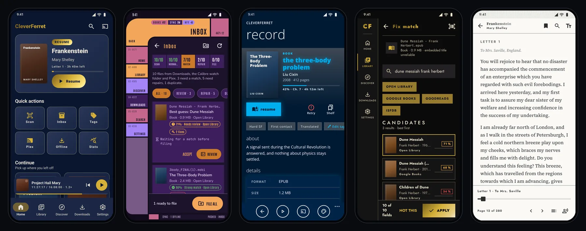

# CleverFerret Design System

Design repo for [CleverFerret](https://github.com/Kaleaon/CleverFerret), a media library app that
catalogues like Calibre and files like Plex. It holds the theme system, an interactive phone
prototype, and the library-management patterns.



## Pages (GitHub Pages)

Served from `docs/` at `https://kaleaon.github.io/Cleverferret-design/` once Pages is enabled (see below).

- **Landing page** (`docs/index.html`): overview, design principles, every colour pack, and the
  screen-to-source map.
- **App prototype** (`docs/app.dc.html`): 20 navigable screens with real state, in four groups.

  - Browse: Home, Library, Discover, Downloads, Settings, Search, Item detail
  - Library management: Import inbox, Fix match, File repair, Sort rules, Calibre plugins, Tag explorer
  - Play & read: Audio player, Queue, Reader, Video player, Reading stats
  - Personalise: Theme Studio, Onboarding

  The side panel switches theme and jumps between screens. Deep links work too, for example
  `app.dc.html?screen=inbox&layout=sweep&palette=lcars&effect=flat`.

- **Theme system** (`docs/theme-system.dc.html`): the spec sheet. It covers live previews (the real
  prototype, embedded), foundations, layout, colour and effect packs, LCARS conformance, a WCAG audit
  of every pack, library-management patterns, components and portable theme JSON.

Everything is static HTML/CSS/JS with no build step. To run it locally, serve `docs/` with any static
server, for example `cd docs && python3 -m http.server`, then open `http://localhost:8000/`.

## How it fits together

```
docs/
  cf-system.js          tokens and resolver: the single source of truth (browser + Node)
  cf-ui.css             UI kit: component classes shared by the app and the spec
  app.dc.html           phone prototype
  theme-system.dc.html  theme spec sheet
  index.html            landing page
  support.js            prototype runtime (React-based; loads React from a CDN at view time)
  assets/               favicon and preview images
design-notes/
  design-language.md    principles, patterns and how they map to the Kotlin code
  calibre-plugins.md    running Kaleaon/calibre_plugins inside the app
  sync-log.md           what was taken from the app repo, and where the two have drifted
  layout-refinement-plan.md  seven-layout acceptance and verification plan
  android-layout-parity.md   source-reviewed native gaps and implementation order
tests/
  verify_contrast.js    WCAG 2.2 AA audit of every colour pack and derived text role
  verify_system.js      structural checks on the token data and the pages
  verify_layouts.mjs    all-screen browser, responsive and interaction regressions
  verify_images.mjs     PNG encoding-independent visual comparison checks
```

`cf-system.js` holds all of the design data:

- 26 colour packs, 7 layout packs and 8 effect packs
- the type, spacing, radius, motion and contrast scales
- status and player tokens
- the library-management data: pipeline, match confidence, repair catalogue, naming conventions, tags and plugin manifests

`CF.resolve(theme)` turns a theme (`{layout, palette, effect, motion}`) into the CSS custom properties
that `cf-ui.css` reads. Change a value there and every page follows.

## Tests

```
node tests/verify_contrast.js
node tests/verify_system.js
```

These two scripts need only Node. The first checks every colour pack after contrast correction. It covers MD3 role
pairs, status colours, reader pages, CTA labels, primary-as-text and nav pills. The second checks that
every pack, layout and effect combination resolves, that each registered screen exists in the
prototype, and that the inbox, naming, tag and plugin data is consistent.

For all seven layout families in Chromium:

```
npm ci
npx playwright install chromium
npm run test:layouts
npm run validate
```

The browser suite exercises all 20 screens, minimum targets, resize behavior and playback.
It serves the exact React runtime locally and uses fallback fonts for repeatable geometry checks.
The contrast suite samples between gradient stops and checks glass wash/surface composites.
`CHROMIUM_PATH` can select a system browser. Unified validation includes these suites; its
landing-page contrast warnings do not constitute a full app accessibility audit.

Landing snapshots load the locked Fontsource Inter/JetBrains Mono fixtures and wait for fonts,
so CDN timing does not change layout. The runner prefers the installed Playwright browser and
compares decoded RGBA pixels (PNG compression/row filters are ignored). Refresh reviewed
baselines with `node tools/ci-runner.mjs --visual --update-snapshots` when appearance changes.
The committed baselines use Ubuntu 24.04 and the locked Playwright browser, matching CI.
Use that environment for exact comparisons; a different Linux font rasterizer can differ even
with identical font files. Inspect the images before accepting a baseline refresh.

## Enabling GitHub Pages (one-time setup)

`.github/workflows/pages.yml` deploys `docs/` on every push to `main`. A repo admin has to set the
Pages source once:

1. Go to **Settings → Pages** on `github.com/Kaleaon/Cleverferret-design`.
2. Under **Build and deployment → Source**, choose **GitHub Actions**.

## Related repos

- App source: [Kaleaon/CleverFerret](https://github.com/Kaleaon/CleverFerret)
- Calibre plugins: [Kaleaon/calibre_plugins](https://github.com/Kaleaon/calibre_plugins)
- Palette and layout reference: Kaleaon/linkpoint-design, Kaleaon/Ktheme

The seven layouts follow [Ktheme universal layout standards v1](https://github.com/Kaleaon/Ktheme/blob/main/docs/universal-layout-standards.md). The published contract is mirrored at `docs/standards/layouts.v1.json`; `node tests/verify_layout_contract.js` verifies token and geometry parity. Its source is Ktheme commit `e50b86d8b032e918a8dc29716a92ae3701e0ca64`, merged in PR #111.
